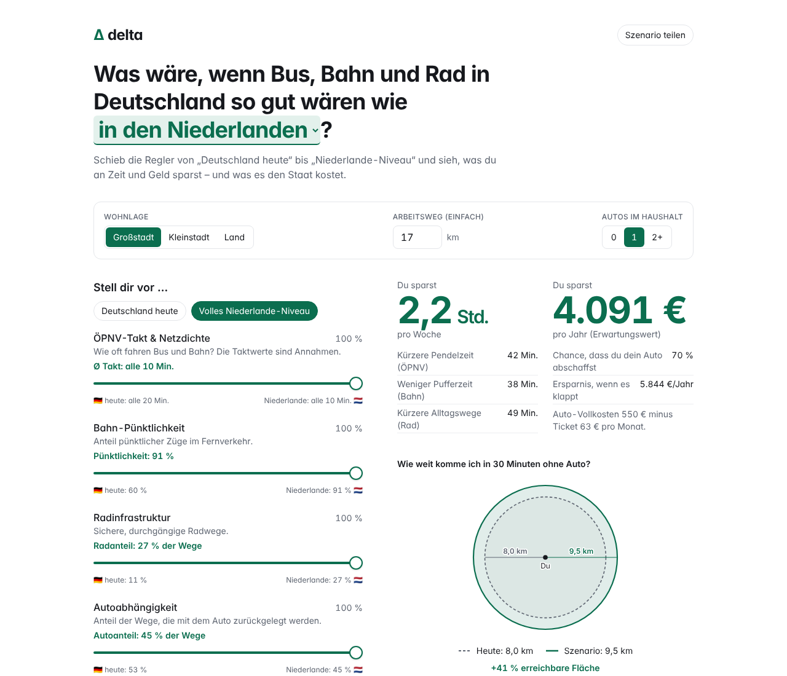
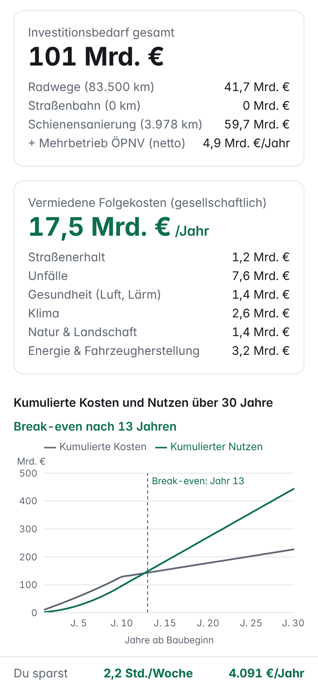
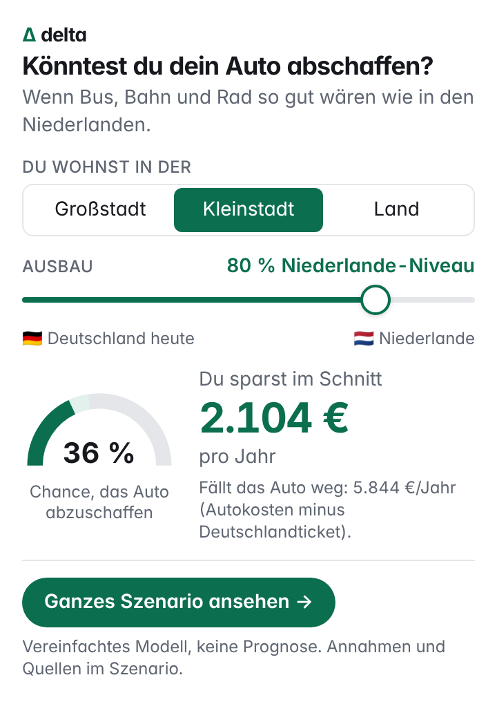
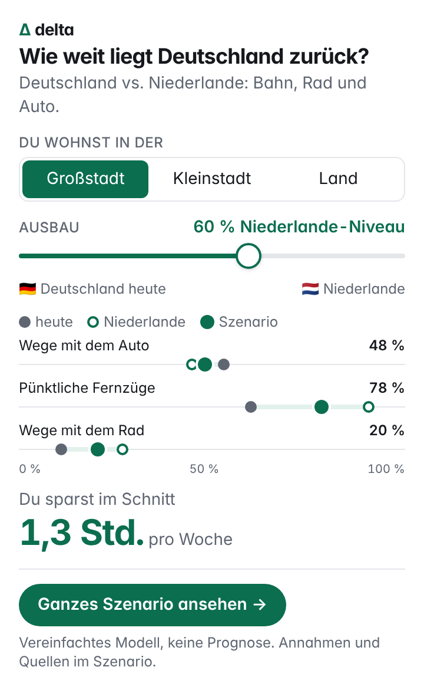
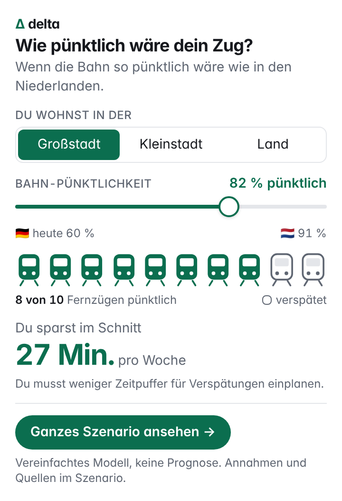

# delta – transport simulator

What would change for you and for the state if public transport, rail and cycling
infrastructure in Germany reached the level of a benchmark country (default: the
Netherlands)? delta is an interactive explainer that makes the orders of magnitude
tangible: **time and money**. It is **not a scientific model and not a forecast**.

The app is in German, as it is aimed at a German audience.

<p>
  
  
</p>

## What it shows

- **Inputs:** four sliders from "Germany today" (0 %) to "benchmark level" (100 %).
  The sliders cover public transport frequency, rail punctuality, cycling
  infrastructure and car dependency. Each one shows its real metric. A compact
  profile sets where you live, your commute distance and how many cars your
  household has. You can also pick the benchmark country.
- **Personal results:** hours saved per week and euros saved per year, animated
  as you move the sliders. A mobility radius shows how far you get in 30 minutes
  without a car, today vs. the scenario.
- **State perspective:** total investment, avoided external costs of car traffic
  per year, and a 30-year cumulative cost–benefit chart with the break-even year
  marked. A CO₂e side effect per person is shown as well.
- **Sharing and transparency:** every scenario can be shared via URL parameters.
  The footer lists every value used, with footnotes to the source list or an
  "Annahme" (assumption) label.
- **Embeddable widget:** three small versions of delta that other websites can
  embed with an iframe: car ownership, Germany vs. the Netherlands, and rail
  punctuality. Each links to the full app with the same scenario. See
  [Embedding the widget](#embedding-the-widget).

## Getting started

```bash
npm install
npm run dev      # development server
npm test         # tests (Vitest)
npm run build    # static build into dist/
npm run preview  # serve the build locally
```

The build is fully static (relative paths) and can be deployed to any web host.

Stack: Vite, React, TypeScript, Tailwind CSS, Recharts and Vitest. There is no
backend.

## Embedding the widget

`widget.html` is a small standalone page for other websites. Visitors pick where
they live and move one slider from "Germany today" to the Netherlands' level.
The button "Ganzes Szenario ansehen" (see the full scenario) opens the full app
in a new tab, with the same scenario prefilled. There are three variants,
chosen with the `v` parameter:

| `v=` | Question | What it shows | Height |
| --- | --- | --- | --- |
| `auto` (default) | "Könntest du dein Auto abschaffen?" (Could you give up your car?) | A gauge with the chance of giving up the car, plus the expected savings per year. The slider moves all four model sliders together. | 540 px |
| `vergleich` | "Wie weit liegt Deutschland zurück?" (How far behind is Germany?) | A dumbbell chart of the share of trips by car, punctual long-distance trains and the share of trips by bike: today, the Netherlands and your scenario on one 0–100 % axis. Plus the time saved per week. | 620 px |
| `bahn` | "Wie pünktlich wäre dein Zug?" (How punctual would your train be?) | How many of 10 long-distance trains are on time, plus the buffer time saved per week. The slider moves only the rail slider. | 550 px |

<p>
  
  
  
</p>

Embed it with a plain iframe:

```html
<iframe src="https://<your-host>/widget.html?v=auto"
        width="100%" height="540" style="border:0;max-width:420px"
        title="delta – Könntest du dein Auto abschaffen?" loading="lazy"></iframe>
```

- Optional parameters: `lage=grossstadt|kleinstadt|land` (where the visitor
  lives) and `niveau=0–100` (the starting slider position, default 100).
- Heights in the table fit phone widths (320 px). At 420 px width, the `auto`
  and `vergleich` variants need about 40 px less.
- The link target is set at build time with `VITE_DELTA_APP_URL` (see
  `.env.example`). If it is empty, the widget links to `index.html` in the same
  folder. The link carries the scenario as URL parameters plus
  `utm_source=widget&utm_medium=embed&utm_content=<variant>`. In the `bahn`
  variant, the other three sliders are set to 0, so the full app shows the same
  numbers.
- The widget sets no cookies and does no tracking.
- The host serving `widget.html` must allow framing: no `X-Frame-Options`
  header, and no `Content-Security-Policy: frame-ancestors` that excludes the
  embedding sites. If an embedding site sandboxes the iframe, it needs
  `allow-scripts allow-popups` for the widget and the link to work.

## Project structure

| Path | Contents |
| --- | --- |
| `src/config/countries.ts` | Metrics per country (Germany + benchmarks), each with a source reference or marked as an assumption |
| `src/config/assumptions.ts` | Model assumptions: costs, effect sizes, location factors |
| `src/config/sources.ts` | Source registry; config values reference it via `[Source: <id>]` |
| `src/config/sliders.ts` | Slider labels and the metric each slider displays |
| `src/model/` | Pure calculation functions without UI, fully tested |
| `src/lib/` | Formatting (de-DE) and URL state for sharing |
| `src/components/` | UI components |
| `src/widget/` | Embeddable widget (`widget.html`): variants, state, link to the app, charts |

## Adding a benchmark country

Add an entry to `BENCHMARKS` in `src/config/countries.ts`. Nothing else is
needed: the model, the dropdown, the slider metrics, the URL parameter and the
footer table all pick the new country up automatically. If a country is worse
than Germany on a metric, the model applies no effect for it rather than a
deterioration.

## Data, sources and assumptions

- The key metrics come from public sources, including MiD 2023, CBS ODiN 2023,
  DB and NS punctuality reports, VDV, INFRAS, UBA, KBA and Destatis. The research
  was done in October 2026.
- Effect sizes such as elasticities and location factors are model assumptions
  and are labelled as such.
- A test (`src/config/sources.test.ts`) checks that every source reference in the
  config and footer points to an existing source.

See [`ASSUMPTIONS.md`](./ASSUMPTIONS.md) for which values are sourced, which are
assumptions, and how gaps were filled.
